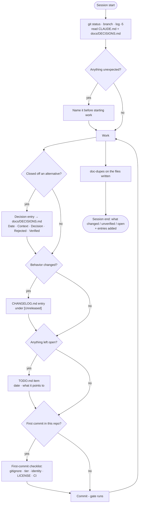

# CLAUDE.md

Guidance for AI coding assistants (Claude Code, Codex) working in this workspace. `AGENTS.md` is a
symlink to this file.

## Overview

A personal development workspace: many independent projects under `projects/`, a template system
under `templates/`, and `dotfiles/` — the public repo holding the security gate, the audit tooling
and the policy docs, with its private companion repo cloned at `dotfiles/private/`. `~/dev` itself
is not a git repo.

The root is the meta layer — workspace docs, `dotfiles/`, `templates/`, audit output. Every distinct
project, scratch code included (`projects/scratch/`), lives under `projects/`, never at the root.

`dotfiles` has two goals: back up this machine's setup, and let others copy what they like. For
anything added there, ask *does it help restore this machine, or would someone copy it?* If
neither, it goes elsewhere or nowhere. Retired material goes to `dotfiles/archive/`.

## Hard rules

What checks each rule, and where: `dotfiles/docs/policy/repo-standards.md` § Enforcement.

- **Nothing reaches GitHub without the full security and privacy check** — private repos included.
  Content goes through `git commit` and `git push`, never through the GitHub API.
- **Every commit and push passes the security gate** (`dotfiles/security/gate.sh`). Never bypass
  it: never use `--no-verify` or `-n`, never touch `core.hooksPath` or `hook.*` config, never ask the
  user to set `SECURITY_GATE_BYPASS`. Fix the finding, or stop and report it.
- **Committer identity is the GitHub noreply address.** Never set a personal email in any repo.
- **Public repo ⇒ LICENSE in the first commit.** Canonical line `Copyright (c) <year> Pieter de Jong`;
  the manifest's `license` field must match.
- **Never relicense or reshape a fork or upstream clone**, and skip them in bulk sweeps.
- **No media or large binaries in git** (video, audio, weights, big datasets) — not even private.
- **A new large data folder in a project needs an explicit backup decision.** `~/dev` is backed up
  by what `.gitignore` keeps, so gitignored data is *not* backed up unless it is listed in
  `~/docs/.backup/dev-includes.txt`. Rebuildable: ignore it. Irreplaceable: ignore it and list it
  there with the reason (`~/docs/BACKUP.md` § ~/dev).
- **Exact version pins** — no `^` or `~`. **One package manager** per project. **Actions pinned by
  commit SHA.**
- **Never write audit output inside a git repo.** Reports go to `~/dev/audit-reports/`, mode 600.
- **Every repo's CI calls the reusable security workflow** (`security-reusable.yml`: gitleaks plus
  the gate) — added when a repo is created or next touched; never to do-not-touch repos, forks or
  upstream clones.
- **Confirm before outward-facing actions:** push, visibility or settings changes, deletes, anything
  published. Never open or print credential files.
- **A "done" needs its verification command and output**, not a statement.
- **Every prompt ends in markdown.** Decisions go in `docs/DECISIONS.md`, open items in the
  repo's `TODO.md` (workspace-level items: `~/dev/TODO.md`), and the files written come out of
  `doc-dupes` clean. Chat, commit messages and the closing summary are not a record. The
  `UserPromptSubmit` hook says so on every prompt; the `Stop` hook holds the turn open until it
  is true or the reply says in one line why nothing is owed.

## Do-not-touch

@dotfiles/private/registers/do-not-touch.md

If that file is missing, ask before modifying any repo under projects/.

## Session workflow

Every session runs the same loop. Steps 2 to 5 are stated in full elsewhere — what follows is the
order they happen in, not a second copy of them.

1. **Open by reading state, not code.** `whatsup` — git state and last commits, the decision
   log's last entry and open `Verified` items, the changelog's `[Unreleased]` block, open TODO
   items — then the project's `CLAUDE.md`. Name anything unexpected — dirty tree, detached HEAD,
   unpushed commits, a stray untracked file — before touching anything. A surprise is cheapest
   before it has been built on. The `SessionStart` hook prints `whatsup --brief` automatically in
   every repo, and at `~/dev` the workspace TODO and recently active repos.
2. **First commit in a repo** follows `dotfiles/docs/policy/security-and-privacy.md` §4 —
   `.gitignore` baseline, data tier, noreply identity, LICENSE, security CI workflow.
3. **A decision that closes off an alternative earns an entry** in the project's
   `docs/DECISIONS.md` (create it on the first entry), in the format and with the `Verified:`
   discipline of `dotfiles/docs/policy/ai-instructions.md` § Decisions need verification. Name the
   alternative that was rejected and why. Not every commit — only a choice someone could reasonably
   reopen later. The `Stop` hook asks at the end of every turn that changed code; answer it with
   the entry or with one line saying why none is owed. The gate blocks an entry with no
   `Verified:` line.
4. **A behavior-relevant change earns a `CHANGELOG.md` entry** under `[Unreleased]`, in the same
   session, per `dotfiles/docs/policy/repo-standards.md` § Changelog. Skip formatting, typo and
   pure-refactor changes, and skip `projects/scratch/`, forks, upstream clones and do-not-touch
   repos. The `Stop` hook asks for it in the same turn; the gate blocks a commit of
   behaviour-relevant files with no `CHANGELOG.md` change.
5. **Open items go to `TODO.md`.** Anything left undone when the turn ends — a `Verified: NOT
   YET`, a follow-up, a check not run, a question for Pieter — is one `- [ ]` line in the repo's
   `TODO.md` (create it on the first item; workspace-level items go in `~/dev/TODO.md`), with the
   date and the decision or report it points to. Tick items, never delete them; an item lives in
   exactly one file and any other file points to it. Per `dotfiles/docs/policy/ai-instructions.md`
   § Open items live in `TODO.md`. The `UserPromptSubmit` hook reminds on every prompt; the
   `Stop` hook blocks a turn whose summary names open work while no `TODO.md` was touched.
6. **Close with a summary**, after `doc-dupes` on the files written is clean: what changed, what is
   unverified, what is still open and where it is written down, and which decision, changelog and
   TODO entries were added. Update the project's README or `CLAUDE.md` in the same session when
   commands or behavior changed; a doc that lags by one session is where drift starts. Say any
   `Verified: NOT YET` out loud rather than leaving it to be discovered. The `Stop` hook blocks
   while a log touched this session holds a duplicate (`ai-instructions.md` § Logs are checked
   for redundancy).



## Where the rules live

Read these when their subject comes up; they are not loaded automatically.

| Doc | Covers |
|---|---|
| `dotfiles/docs/policy/security-and-privacy.md` | Data tiers, the gate, bypass, first-commit and go-public checklists, leaks, CI scanning, GitHub baseline, guardrails |
| `dotfiles/docs/policy/secure-development.md` | Threat model, auth, input/output, runtime secrets, web defaults, logging, SAST, pre-ship checklist |
| `dotfiles/docs/policy/privacy-by-design.md` | Data classes, minimization, retention and deletion, other people's data, processors |
| `dotfiles/docs/policy/supply-chain.md` | Adding dependencies, lockfiles, Actions pinned by SHA, vulnerability response, deployed surfaces |
| `dotfiles/docs/policy/ai-and-external-services.md` | What may go to a hosted model, connector writes, prompt injection, permission allowlists |
| `dotfiles/docs/policy/repo-standards.md` | Licensing, GitHub tiers, `.gitignore` baseline, `init.sh`/`test.sh`/`run.sh`, dependencies, media, lint, changelog |
| `dotfiles/docs/policy/ai-instructions.md` | Instruction-file layering, `CLAUDE.md` vs memory, decision records, TODO items, the redundancy check |
| `dotfiles/docs/policy/backups.md` | Backup principles |
| `dotfiles/docs/design-decisions.md` | Why the gate, audit and public/private split are built this way |
| `dotfiles/docs/maintenance.md` | The weekly security audit and what to do with its findings |
| `dotfiles/docs/containers.md` | Colima on demand (no Docker Desktop), local vs hosted Supabase, native Postgres, what needs Docker |
| `dotfiles/docs/dev-audit.md` | `dotaudit`: read-only audit of every local repo |
| `dotfiles/private/registers/` | Private: repo inventory (`repos.md`: what each directory is, its shape, deploy target, Docker fit), open findings, per-repo privacy, licensing, GitHub baseline, backup state |
| `dotfiles/private/reports/` | Private: dated audit reports (point-in-time, not maintained) |

Before claiming any sweep covered "all repos", check the GitHub baseline register — not every
GitHub repo is cloned here.

Workspace notes that stay at the root: `TODO.md` (open work), `IDEAS.md` (retired project sketches —
check before starting something that sounds familiar). What each project is lives in the private
repo inventory, `dotfiles/private/registers/repos.md`.

## Model selection for coding (as of Oct 2026, re-check quarterly)

Judge models by cost per *successful* task (retries + review time), not token price.
Benchmarks are harness-sensitive; mostly vendor-reported via aggregators.

### Routing
- **Default coding agent:** Claude Sonnet 5.5 (`claude-sonnet-5-5`, $2/$10 per MTok)
  or GPT-6 Sol ($2/$10). Same list price; pick whichever does better in the current harness.
- **High-volume, well-scoped work** (tests, boilerplate, refactors, migrations):
  Gemini 3.8 Flash (~$0.75/MTok input) or DeepSeek V4-Pro (~$0.44/$0.87, open weights).
- **Escalation only** (multi-file design, problems cheaper models keep failing):
  Claude Opus 5.5 / Fable.
- **Open-weight quality pick:** GLM-5.3 or Kimi K3. Only DeepSeek is clearly cheaper
  per solved task than closed models.

### Rules of thumb
- Use medium/high effort by default. Max effort can make Sonnet 5.5 cost more per task than Opus 5.5.
- Use prompt caching. Cache reads are ~10x cheaper ($0.20/MTok on Sonnet 5.5).
- Before switching defaults, run 10–20 real tasks from my own repos through the top 2 candidates.

## Templates (`templates/`)

Five curated stacks. Three have `minimal-mvp` and `production-ready` variants; `rn-supabase` and
`vercel-stack` are single production-oriented layouts (`templates/DEPENDENCY_MATRIX.md`).

| Stack | Dir | Variants | Description |
|---|---|---|---|
| Python FastAPI | `templates/py-fastapi/` | minimal-mvp, production-ready | REST API, Pydantic; optional PostgreSQL/Redis/JWT |
| TypeScript React | `templates/ts-web/` | minimal-mvp, production-ready | Vite + React; optional Tailwind/React Query/Vitest |
| Node.js Express | `templates/node-express/` | minimal-mvp, production-ready | Express + TypeScript; optional PostgreSQL/Docker |
| React Native + Supabase | `templates/rn-supabase/` | single | Expo + Supabase auth and database |
| Next.js on Vercel | `templates/vercel-stack/` | single | Next.js App Router + Supabase auth/Postgres |

```bash
cd templates/<stack>/<variant>   # or templates/rn-supabase
./init.sh        # venv or node_modules; .env from template
./run.sh         # dev server (default)
./run.sh build   # production build
./run.sh test    # tests (production-ready variants)
./run.sh lint    # linters
./run.sh format  # auto-format
```

Production-ready variants add `./run.sh prod`, `./run.sh debug`, `./run.sh type-check`.

Dev servers: py-fastapi `http://localhost:8000` (docs at `/docs`) · ts-web `http://localhost:5173` ·
node-express `http://localhost:3000` · vercel-stack `http://localhost:3000` (don't run with
node-express) · rn-supabase: Expo QR code, `w` for web.

- **py-fastapi/production-ready** needs a running Docker daemon — `colima start` first (PostgreSQL + Redis); `./run.sh` runs `alembic upgrade head`.
- **rn-supabase** needs Node 24 (`.nvmrc`), the Supabase CLI and a running Docker daemon (`colima start`); `./init.sh` starts local Supabase at `http://localhost:54321`. Every check: `./test.sh` (`--integration` for the live Supabase round-trip, `--scaffold` for the new-app test). Releases: its `docs/RELEASE.md`.
- Every template ships `.github/workflows/ci.yml`; it runs once the new project is pushed.
- Scaffold by copying the directory; don't change dependency versions until `./init.sh` succeeds.
  **`rn-supabase` is its own git repo** (private `rn-supabase-template`): create a new app with
  `templates/rn-supabase/scripts/scaffold.sh <app-dir>` (copies without `.git`, `node_modules`, env
  files or local Supabase state; a plain copy that keeps `.git` is refused by its `init.sh`).
- **node-express/production-ready** needs a running Docker daemon for anything that touches the
  database (`colima start`, then `docker compose up -d db redis` and `./run.sh migrate`); its unit
  and supertest tests run without one. Repaired 2026-10-17 (`templates/AUDIT_2026-10-17.md`).
- **Not templates:** `general/`, `py-django/`, `py-flask/`, `py-fullstack/`, `ts-server/`,
  `rn-supabase-legacy/` and the `base-app` / `base-api` / `framework-base` subdirs are separate
  repos with their own remotes, several with uncommitted work. Don't scaffold from them and don't
  include them in sweeps over `templates/`. Per-directory state: `templates/INVENTORY.md`.
  `templates/` itself is not a git repo; of the curated templates only `rn-supabase` is one.

## Per-project CLAUDE.md

Most projects don't need one. Create it when a project is a git repo with real build/test/lint
tooling, or once you are doing substantive work in it — never batch-generated. Shape: Overview ·
Commands (exact) · Architecture (only the non-obvious) · Gotchas. Details:
`dotfiles/docs/policy/ai-instructions.md`.