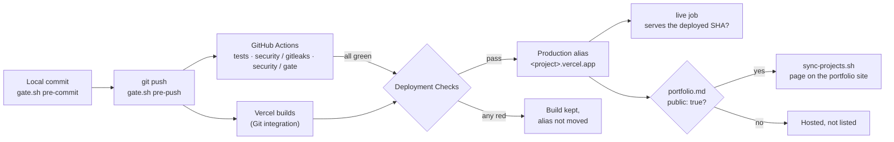

# Deploy pipeline: local → GitHub → Vercel → portfolio

How a project goes from this machine to a URL, and onto the portfolio site if it should be
listed. This is the one path every web project follows. Why it is built this way: decision D42
in [design-decisions.md](design-decisions.md).



## 1. GitHub: security and privacy before anything leaves

Nothing here is new. It is the existing policy, listed in pipeline order:

- **First commit:** `.gitignore` baseline, data tier, noreply identity, LICENSE, security CI
  ([security-and-privacy.md §4](policy/security-and-privacy.md#4-before-a-repos-first-commit)).
  New repos start private.
- **Every commit and push:** `security/gate.sh` (§2). It blocks a push to an own repo with no
  `security.yml` (`no-security-ci`).
- **In CI:** `.github/workflows/security.yml` calls `security-reusable.yml`, which runs gitleaks
  over the full history and the gate in `ci` mode (§9).
- **Repo settings:** `scripts/github-security-sweep.sh` (§10).
- **Going public:** the go-public checklist (§5). The portfolio only lists public repos.

Each repo also has its own `ci.yml` with a job named **`tests`** that runs `./test.sh --offline`
([repo-standards.md](policy/repo-standards.md) § Scripts). The name matters: Vercel's Deployment
Checks match GitHub checks by name.

## 2. Vercel: one project per repo, gated on CI

Run once in the repo:

```bash
vercel-project init --dry-run   # what it would do
vercel-project init             # do it
vercel-project check            # later: exit 1 if the settings drifted
```

`bin/vercel-project` uses the `vercel` CLI's own login, so no token ever goes into GitHub. It
refuses any repo whose `origin` owner isn't `pieteradejong`.

The project is named after the repo unless you pass `--name`. `<name>.vercel.app` is first come,
first served across all of Vercel, so `init` refuses a new name whose address already answers
(`cnc-web.vercel.app` is someone else's site, so the games repo uses `cnc-web-padj`). After the
first `init`, the linked name in `.vercel/project.json` is used.

`vercel link` also writes a short-lived `VERCEL_OIDC_TOKEN` into `.env.local` and appends `.env*`
to `.gitignore`, which re-ignores `.env.example`. `init` undoes both: it restores `.gitignore` and
deletes the token file if this run created it. It refuses to run where `.env.local` isn't already
ignored.

It sets:

| Setting | Value | Why |
|---|---|---|
| Git integration | `main` → production, other branches → previews | Push is the deploy. Nothing to run by hand. |
| `gitProviderOptions.createDeployments` | `enabled` | Without it GitHub gets no `deployment_status` and the live check never runs. |
| `ssoProtection` | `all_except_custom_domains` (Standard Protection) | Previews need a Vercel login. Production stays public ([supply-chain.md §6](policy/supply-chain.md#6-deployed-surfaces)). |
| Deployment Checks | `tests`, `security / gitleaks`, `security / gate`; `blocks: deployment-alias`, production only | A red test or a red gate never reaches production. Vercel keeps the build and doesn't move the alias. |
| Node version | from `.nvmrc`, only when `package.json` has no `engines.node` | `engines` wins on Vercel anyway. |

A build that is held can be inspected with `vercel ls <project>` and promoted by hand
(`vercel promote <url>`, or "Force Promote" in the dashboard) when the failing check is known to
be unrelated.

**Exception, the build can't run on Vercel.** If the build needs a tool Vercel's image lacks, or
data too big to fetch on every build, GitHub Actions builds and deploys with
`vercel deploy --prebuilt`. The token lives in a GitHub environment restricted to `main`.
`eu27-data-sovereignty` and `christ` work this way. Each such repo records why in its own decision
log.

## 3. Live check: production serves the commit

Every page carries `<meta name="build-commit" content="<sha>">`, injected at build time from
`VERCEL_GIT_COMMIT_SHA`. The repo's `ci.yml` adds a job that calls the reusable workflow:

```yaml
on:
  push: { branches: [main] }
  pull_request:
  deployment_status:
  workflow_dispatch:
permissions:
  contents: read
jobs:
  tests:
    # the repo's own ./test.sh --offline
  live:
    uses: pieteradejong/dotfiles/.github/workflows/vercel-live-reusable.yml@main
    with:
      site_url: https://<project>.vercel.app
      command: ./test.sh --live https://<project>.vercel.app   # optional
```

The job runs only on a successful production `deployment_status`, or by hand. It polls until the
production URL serves the deployed SHA. A red `live` after a green build means the alias was held
by a failing check, or that production is up and broken.

## 4. Portfolio: the `public` flag

Whether a project is listed on the portfolio site has nothing to do with hosting. Every project
gets its Vercel URL. The flag lives in the project repo, in `portfolio.md` at the root:
frontmatter in the portfolio site's project schema, plus `public: true|false`, plus the page body.

The portfolio repo (`astropieter`) pulls these in with `scripts/sync-projects.sh`:

- It reads `portfolio.md` from every public repo.
- It writes or removes the generated pages on a branch.
- Pushing that repo's `main` publishes them.

A private repo is never listed, whatever its flag says. The page format, the checks a page must
pass, and the sync are documented in that repo's `docs/PORTFOLIO.md`.

## 5. Checklist for a new project

1. First commit per §1, including `security.yml`, and `ci.yml` with `tests`.
2. Add the `build-commit` meta tag to the page template.
3. `vercel-project init`, then `vercel-project check` (exit 0).
4. Add the `live` job to `ci.yml`, push, and wait for `tests`, `security` and `live` to go green.
5. To list it: the repo goes public (go-public checklist), write `portfolio.md` with
   `public: true`, then run the sync in the portfolio repo.

## Limits and cost

Vercel Hobby (free) covers many low-traffic projects: 200 projects, 100 GB transfer and 1M
requests a month, pooled across the account. The limit to watch is **100 deployments a day
across all projects**: every push and every preview counts. Hobby is for non-commercial use only.
Anything that earns money moves to Pro ($20 a month per seat).
