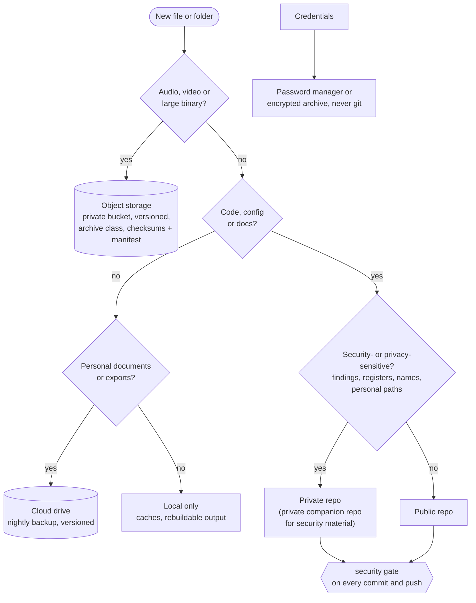

# Backups

Principles for keeping work and personal data recoverable. What is actually covered, source by
source, is in the private companion repo (`../../private/registers/backup-state.md`), not published.

---

## Where things go

One question at a time decides the destination. Who can see each destination is in
[security-and-privacy § Trust zones](security-and-privacy.md#trust-zones-who-can-see-what).

- **Media never goes in git**, not even a private repo ([media](repo-standards.md#media-and-large-binaries)).
  It goes to object storage with a checksum file and a manifest, which stay in a readable storage
  class so a restore can be checked without a thaw.
- **Back up, don't offload.** A copy in object storage does not make the local file deletable.
  Deleting the local file is a separate decision, made per item.

---

## Coverage

- **3-2-1 as the target:** at least three copies, on two kinds of storage, one off the machine.
  A single disk plus good intentions is one copy.
- **A git remote backs up commits, nothing else.** Uncommitted work, gitignored data and media,
  local-only branches and directories that were never `git init`'d have no copy. Every repo gets
  a remote (private by default) and nothing stays unpushed for long.
- **Know the uncovered set.** Keep a written list of what has no off-machine copy — each gap
  should be a decision, not an accident. Retiring a mechanism (a disconnected backup disk) is a
  recorded decision too.
- **Media and large data outside git need their own backup**, recorded in the project's
  `assets/README.md` with sha256 and the canonical location ([media](repo-standards.md#media-and-large-binaries)).
- **Large local archives** (message stores, exports) get an explicit off-machine destination
  before they are considered safe; append-only archives grow every run, so budget for it.
- **The scripts that run the backups are themselves backed up** — in a repo with a remote, one
  live copy, no stale duplicates that look authoritative.

## Credentials need a backup location too

Excluding credentials from a cloud sync is right; leaving them with no backup at all is not.
Recovery codes and keys belong in a password manager or an encrypted archive (`age`/`gpg`) on a
separate remote — never un-excluded as plaintext, and never loose in a workspace directory.

## Exports: originals first

- Keep the highest-fidelity original (native format) in an `originals/` directory before any
  conversion; derive text, Markdown or a search index alongside it.
- One project per source, independently regenerable; a manifest maps each source item to its files.
- Byte-copy with checksums; never open a live source database in a way that can modify it.

## Signals must be trustworthy

- **A backup that reports failure every night trains everyone to ignore it** — fix false alarms
  first; a real failure is otherwise indistinguishable.
- **Verify the effect, not the log.** A scheduled job can "succeed" while doing nothing (missing
  disk access permissions under launchd). Check that space was freed, files arrived, state flipped.
- **Filter rules are paths too** — an anchored exclude can match during sync and miss during
  verify when the root differs. Test both.
- **On-demand success is necessary, not sufficient.** Confirm the next unattended run.
- **Watch for expiring dependencies** (shared OAuth client IDs, tokens); an auth outage looks like
  every other failure.
- **Versioned destinations need a retention policy**, or they grow without bound.

## Restores are the test

- Periodically restore a sample to a scratch location and compare checksums. A backup never
  restored is a hypothesis.
- If backup copies vanish and the cause is unknown, regenerating them is not a fix — find what is
  deleting them first.
- Dotfile restores snapshot the live files before overwriting, so a bad restore is itself recoverable.
